# Verdict review: final runs (judge_v3)

Every verdict of the four final runs, with a short review of each: where was the judge wrong?
Generated by `harness/review.py --out verdict_final_review.md`; the "My review" lines are mine.

## Summary

- **21 judgments, parity decision right in 19.** Both errors were a first judgment saying "yes" too early (beaver round 03, Santa round 03), and the A/B-swapped confirmation caught both. No false success reached the end of a run.
- **One borderline success.** Beaver round 04 passed both judgments, but the reference is a bit richer. It passed partly because the reference scored lower in that round (noise).
- **Defects are real and specific.** Each round's attempt defects match what I see, and the refiner used them (pelican legs, beaver kitchen, monkey apples).
- **Where the loop fails, it is Haiku, not the judge.** On the monkey, the judge named the same real problem three times (hands and feet not attached); Haiku never fixed it. On Santa, Haiku kept drawing one present in hand instead of a stack.

## out-final-v3-pelican

Prompt: _Generate an SVG of a pelican riding a bicycle._  
Stop: **parity** after round 1, final = round 1, total $0.3302

### out-final-v3-pelican · round 00

| reference | attempt |
|---|---|
| 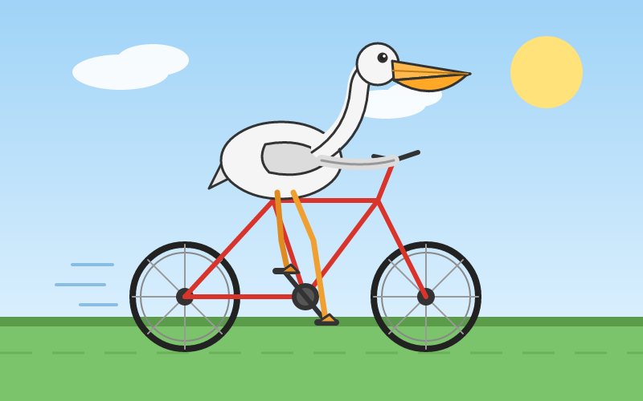 | 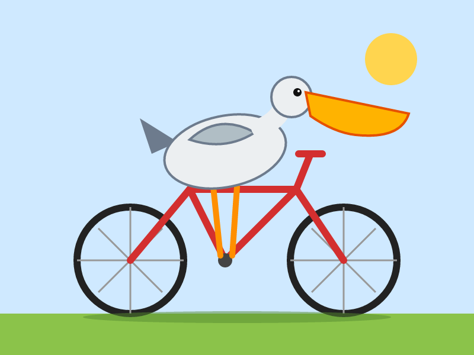 |

| | main | background | count | shape | contact | clean | color | total |
|---|---|---|---|---|---|---|---|---|
| reference, judgment | 4 | 4 | 5 | 4 | 4 | 4 | 5 | **30** |
| attempt, judgment | 3 | 4 | 4 | 3 | 2 | 4 | 5 | **25** |

Judge: parity **no**. _A totals 25 and B totals 30, so the totals differ by more than 1. Contact also differs by 2 (2 vs 4), so the images are not at parity, even though neither has a critical defect._

**Attempt defects (judge):**

- **major** (contact): The bicycle has no cranks or pedals, and both legs end together at the bottom bracket hub, so the bird is not pedalling _Where:_ the pelican's legs and the bike's centre hub. _Expected:_ Each foot rests on its own pedal, attached to cranks on the bottom bracket, so the bird is clearly riding
- **major** (main): The pelican does not steer: no wing or other part reaches the handlebar _Where:_ the pelican's wing and the handlebar. _Expected:_ A wing reaches forward and rests on the handlebar, showing the bird is riding the bike
- **major** (contact): There is no saddle, and the body sits directly on the top tube _Where:_ under the pelican's body. _Expected:_ The bike has a saddle and the pelican's body sits on it
- **minor** (shape): The neck is a short stub, so the head looks stuck onto the front of the body, and the beak is almost as long as the body _Where:_ the pelican's head and neck. _Expected:_ A visible neck joins the head to the body, and the beak is large but in proportion
- **minor** (background): The setting is very bare, with only a plain sky, a sun and a flat green strip _Where:_ the whole background. _Expected:_ A simple outdoor setting, such as a road or path, that shows where the bike is riding while still keeping the focus on the rider

**Reference defects (judge, never shown to the refiner):**

- **major** (contact): There is no saddle, and the body floats just above the top tube _Where:_ under the pelican's body. _Expected:_ The bike has a saddle and the pelican's body sits firmly on it
- **minor** (shape): The neck is very long and thin, which makes the bird look more like a heron than a pelican _Where:_ the pelican's neck. _Expected:_ A thicker, shorter neck that fits a pelican's build
- **minor** (clean): A cloud sits right behind the head and beak, so their outlines blend into it _Where:_ upper middle, around the pelican's head. _Expected:_ The head and beak stand out against clear sky
- **minor** (contact): The wing tip only just touches the end of the handlebar and does not look like it is holding it _Where:_ the pelican's wing at the handlebar. _Expected:_ The wing tip clearly wraps around or rests on the handlebar grip

**My review:** **Right (no parity).** The legs are two straight sticks to the crank, with no feet on the pedals, and the oversized beak dominates. The reference is clearly better.

---

### out-final-v3-pelican · round 01

| reference | attempt |
|---|---|
|  | 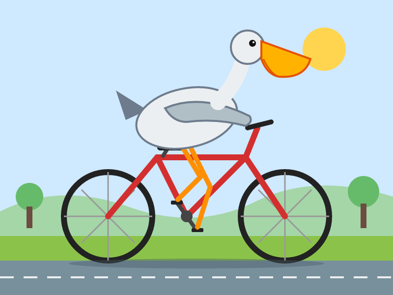 |

Feedback the refiner received for this round (from round 00): 5 defect(s) passed, 0 dropped

- **major** (contact): The bicycle has no cranks or pedals, and both legs end together at the bottom bracket hub, so the bird is not pedalling _Where:_ the pelican's legs and the bike's centre hub. _Expected:_ Each foot rests on its own pedal, attached to cranks on the bottom bracket, so the bird is clearly riding
- **major** (main): The pelican does not steer: no wing or other part reaches the handlebar _Where:_ the pelican's wing and the handlebar. _Expected:_ A wing reaches forward and rests on the handlebar, showing the bird is riding the bike
- **major** (contact): There is no saddle, and the body sits directly on the top tube _Where:_ under the pelican's body. _Expected:_ The bike has a saddle and the pelican's body sits on it
- **minor** (shape): The neck is a short stub, so the head looks stuck onto the front of the body, and the beak is almost as long as the body _Where:_ the pelican's head and neck. _Expected:_ A visible neck joins the head to the body, and the beak is large but in proportion
- **minor** (background): The setting is very bare, with only a plain sky, a sun and a flat green strip _Where:_ the whole background. _Expected:_ A simple outdoor setting, such as a road or path, that shows where the bike is riding while still keeping the focus on the rider

| | main | background | count | shape | contact | clean | color | total |
|---|---|---|---|---|---|---|---|---|
| reference, judgment | 4 | 5 | 5 | 3 | 3 | 4 | 5 | **29** |
| attempt, judgment | 5 | 4 | 5 | 4 | 4 | 3 | 4 | **29** |
| reference, confirmation (A/B swapped) | 4 | 5 | 5 | 4 | 4 | 4 | 5 | **31** |
| attempt, confirmation (A/B swapped) | 4 | 5 | 4 | 4 | 4 | 4 | 5 | **30** |

Judge: parity **yes**; confirmation: parity **yes**. _No criterion differs by more than 1 point, both totals are 29, and neither image has a critical defect, so all three parity conditions are met._

**Attempt defects (judge):**

- **major** (clean): The beak and pouch overlap the yellow sun, so the two shapes merge and the beak's outline is hard to read _Where:_ upper right, at the beak. _Expected:_ The beak stands out clearly against open sky, and the sun sits apart from it
- **minor** (background): The sun sits right behind the bird's head and draws the eye away from the rider _Where:_ upper right sky. _Expected:_ The sun is placed where it does not compete with the pelican's head
- **minor** (color): The yellow-orange beak is close in colour to the yellow sun behind it, so there is little contrast between them _Where:_ the beak against the sun. _Expected:_ The beak contrasts clearly with whatever lies behind it
- **minor** (contact): The wing tip only roughly meets the handlebar instead of clearly holding it _Where:_ the front of the wing at the handlebar. _Expected:_ The wing tip clearly grips the handlebar
- **minor** (shape): The neck joins the body as a separate tube with a round blob at its base, which looks pasted on _Where:_ where the neck meets the body. _Expected:_ The neck flows smoothly into the body

**Reference defects (judge, never shown to the refiner):**

- **major** (contact): The bicycle has no saddle or seat post, so the pelican's body floats above the top tube with nothing holding it up _Where:_ the middle of the bicycle under the bird's body. _Expected:_ The pelican sits on a visible saddle that is joined to the bicycle frame
- **major** (shape): The bicycle frame is oddly built: the tubes do not form a normal triangle with a seat tube rising from the pedals to the seat _Where:_ the red bicycle frame. _Expected:_ The frame reads as a normal bicycle, with a seat tube going up from the crank to the saddle
- **minor** (shape): The neck is very long and thin, which makes the bird look more like a stork than a pelican _Where:_ the bird's neck. _Expected:_ The pelican has a shorter, thicker neck that suits a pelican
- **minor** (contact): The wing only just reaches the handlebar and does not clearly grip it _Where:_ the front of the bird's wing at the handlebar. _Expected:_ The wing tip clearly rests on the handlebar
- **minor** (clean): The legs cross the frame tubes in a way that makes the crank area hard to read _Where:_ around the pedals and crank. _Expected:_ The legs and the frame stay easy to tell apart near the pedals

**My review:** **Right (parity, confirmed).** One refine fixed the main problems: the legs bend down to the pedals, a wing reaches the handlebar, and there is a road. The reference is a little more polished (motion lines, full spokes), but parity is fair.

---

## out-final-v3-beaver

Prompt: _A beaver is cooking sunshine eggs_  
Stop: **parity** after round 4, final = round 4, total $0.8232

### out-final-v3-beaver · round 00

| reference | attempt |
|---|---|
| 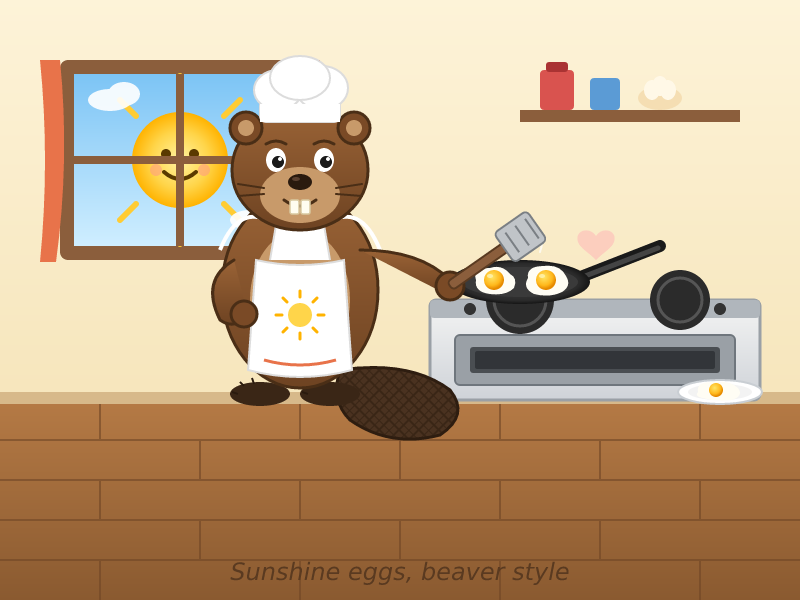 | 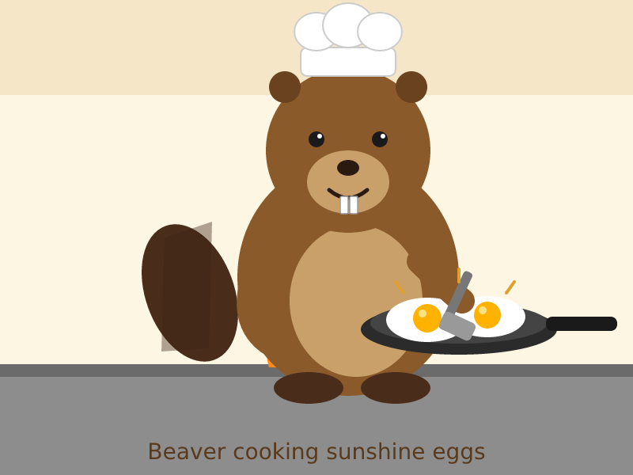 |

| | main | background | count | shape | contact | clean | color | total |
|---|---|---|---|---|---|---|---|---|
| reference, judgment | 5 | 4 | 4 | 4 | 4 | 4 | 5 | **30** |
| attempt, judgment | 3 | 3 | 4 | 3 | 2 | 2 | 4 | **21** |

Judge: parity **no**. _Contact (2 vs 4) and clean (2 vs 4) each differ by 2, and the totals differ by 9 (21 vs 30), so the images are not at parity._

**Attempt defects (judge):**

- **major** (contact): The frying pan floats in front of the beaver's belly. No paw grips its handle and it is not resting on any cooking surface. _Where:_ the frying pan at the right of the beaver's body. _Expected:_ The pan should clearly sit on a stove or be held by its handle in the beaver's paw, so the beaver is visibly cooking.
- **major** (main): There is no stove, heat source or kitchen setting, so the beaver looks like it is holding a pan rather than cooking eggs. _Where:_ the area around and below the pan. _Expected:_ A stove or burner under the pan should show that the eggs are being cooked.
- **major** (clean): A see-through brownish rectangle overlaps the tail and looks like a leftover shape. _Where:_ the beaver's tail on the left. _Expected:_ The tail should be one clean, solid flat tail with no stray overlapping panel.
- **minor** (clean): A small orange fragment pokes out near the beaver's left foot and has no clear meaning. _Where:_ bottom of the beaver's body, near the left foot. _Expected:_ No stray fragments around the feet.
- **minor** (shape): The arms are vague blobs merged into the body, and the chef's hat floats slightly above the head. _Where:_ the beaver's arms and the top of the head. _Expected:_ The arms should be clearly drawn reaching to the spatula and pan, and the hat should sit on the head.

**Reference defects (judge, never shown to the refiner):**

- **minor** (contact): The pan seems to hover slightly above the burner instead of resting on it. _Where:_ the frying pan over the stove top. _Expected:_ The pan should sit flat on the burner.
- **minor** (shape): The arm holding the spatula is very long and thin compared with the beaver's other short, stubby arm. _Where:_ the beaver's right arm reaching to the pan. _Expected:_ Both arms should have matching, believable proportions for a chubby beaver.
- **minor** (clean): A floating pink heart above the pan is an unexplained stray shape. _Where:_ above the right end of the pan. _Expected:_ Decorative extras should clearly belong to the scene, or be left out.
- **minor** (background): The large, bright smiling sun in the window competes for attention with the beaver. _Where:_ the window in the upper left. _Expected:_ The window should stay a quieter backdrop so the beaver and eggs remain the focus.

**My review:** **Right (no parity).** The beaver holds a pan in the air with no stove, and the tail looks pasted on, with a pale rectangle behind it. Both drawings have a caption; the judge did not reward or punish either for it.

---

### out-final-v3-beaver · round 01

| reference | attempt |
|---|---|
|  | 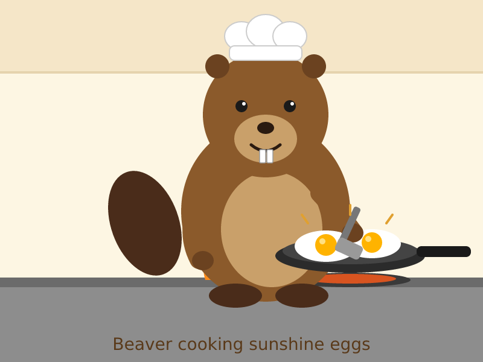 |

Feedback the refiner received for this round (from round 00): 5 defect(s) passed, 0 dropped

- **major** (contact): The frying pan floats in front of the beaver's belly. No paw grips its handle and it is not resting on any cooking surface. _Where:_ the frying pan at the right of the beaver's body. _Expected:_ The pan should clearly sit on a stove or be held by its handle in the beaver's paw, so the beaver is visibly cooking.
- **major** (main): There is no stove, heat source or kitchen setting, so the beaver looks like it is holding a pan rather than cooking eggs. _Where:_ the area around and below the pan. _Expected:_ A stove or burner under the pan should show that the eggs are being cooked.
- **major** (clean): A see-through brownish rectangle overlaps the tail and looks like a leftover shape. _Where:_ the beaver's tail on the left. _Expected:_ The tail should be one clean, solid flat tail with no stray overlapping panel.
- **minor** (clean): A small orange fragment pokes out near the beaver's left foot and has no clear meaning. _Where:_ bottom of the beaver's body, near the left foot. _Expected:_ No stray fragments around the feet.
- **minor** (shape): The arms are vague blobs merged into the body, and the chef's hat floats slightly above the head. _Where:_ the beaver's arms and the top of the head. _Expected:_ The arms should be clearly drawn reaching to the spatula and pan, and the hat should sit on the head.

| | main | background | count | shape | contact | clean | color | total |
|---|---|---|---|---|---|---|---|---|
| reference, judgment | 5 | 4 | 5 | 4 | 4 | 4 | 5 | **31** |
| attempt, judgment | 3 | 3 | 4 | 3 | 2 | 3 | 4 | **22** |

Judge: parity **no**. _B outscores A by 2 on main and contact, and the totals differ by 9 (A 22, B 31). Rules 1 and 2 both fail, so parity is false._

**Attempt defects (judge):**

- **major** (contact): The frying pan floats in mid-air in front of the beaver's belly, above a flat red burner shape, with no stove under it and no paw holding its handle. _Where:_ the frying pan and the red burner, lower right. _Expected:_ The pan clearly rests on a visible stove or burner, or the beaver clearly holds its handle.
- **major** (main): The beaver has no clear arms. A small bump on each side stands in for a paw, so it does not clearly look like it is cooking with the spatula. _Where:_ the beaver's arms and paws. _Expected:_ Visible arms reaching to the pan, with one paw clearly gripping the spatula.
- **major** (background): The setting is only a plain two-tone wall and a grey counter. It has no stove, shelf or window, so it barely reads as a kitchen. _Where:_ the whole background. _Expected:_ A recognisable kitchen setting, such as a stove and some kitchen details, that supports the cooking scene without distracting from it.
- **minor** (clean): A stray orange sliver sticks out from behind the beaver's left foot and is not part of anything. _Where:_ bottom, near the beaver's left foot. _Expected:_ No stray fragments around the beaver's feet.
- **minor** (shape): The chef's hat sits on top of the head like a separate cut-out, and its band is not shaped to fit the head. _Where:_ the chef's hat. _Expected:_ The hat sits snugly on the beaver's head, between or over the ears.

**Reference defects (judge, never shown to the refiner):**

- **minor** (contact): The pan sits above the stove's top edge instead of resting on a burner, so it looks slightly lifted. _Where:_ the frying pan on the stove, right side. _Expected:_ The pan clearly rests on one of the stove's burners.
- **minor** (shape): The arm holding the spatula is very thin and stretched long compared with the beaver's chubby body. _Where:_ the beaver's right arm, holding the spatula. _Expected:_ An arm in proportion with the beaver's plump body.
- **minor** (background): The large, bright smiling sun in the window competes for attention with the beaver. _Where:_ the window, upper left. _Expected:_ Window details that stay secondary to the beaver and the eggs.
- **minor** (clean): A floating pink heart shape near the pan handle is not connected to anything and looks like a stray mark. _Where:_ above the pan handle, right of center. _Expected:_ Decorative touches read clearly as intentional, or are left out.

**My review:** **Right (no parity).** Almost the same drawing as round 00; Haiku only added a stove glow under the pan. The small score change (+1) is noise.

---

### out-final-v3-beaver · round 02

| reference | attempt |
|---|---|
|  | 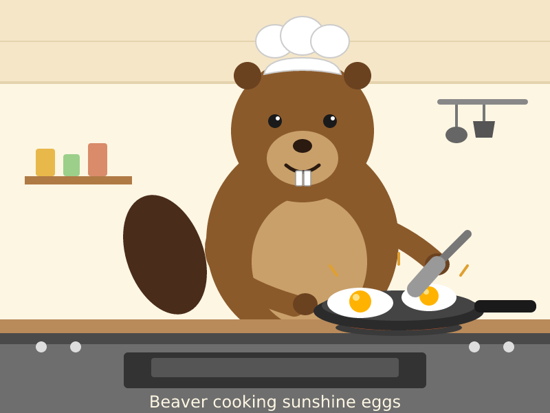 |

Feedback the refiner received for this round (from round 01): 5 defect(s) passed, 0 dropped

- **major** (contact): The frying pan floats in mid-air in front of the beaver's belly, above a flat red burner shape, with no stove under it and no paw holding its handle. _Where:_ the frying pan and the red burner, lower right. _Expected:_ The pan clearly rests on a visible stove or burner, or the beaver clearly holds its handle.
- **major** (main): The beaver has no clear arms. A small bump on each side stands in for a paw, so it does not clearly look like it is cooking with the spatula. _Where:_ the beaver's arms and paws. _Expected:_ Visible arms reaching to the pan, with one paw clearly gripping the spatula.
- **major** (background): The setting is only a plain two-tone wall and a grey counter. It has no stove, shelf or window, so it barely reads as a kitchen. _Where:_ the whole background. _Expected:_ A recognisable kitchen setting, such as a stove and some kitchen details, that supports the cooking scene without distracting from it.
- **minor** (clean): A stray orange sliver sticks out from behind the beaver's left foot and is not part of anything. _Where:_ bottom, near the beaver's left foot. _Expected:_ No stray fragments around the beaver's feet.
- **minor** (shape): The chef's hat sits on top of the head like a separate cut-out, and its band is not shaped to fit the head. _Where:_ the chef's hat. _Expected:_ The hat sits snugly on the beaver's head, between or over the ears.

| | main | background | count | shape | contact | clean | color | total |
|---|---|---|---|---|---|---|---|---|
| reference, judgment | 5 | 4 | 5 | 4 | 4 | 4 | 5 | **31** |
| attempt, judgment | 4 | 5 | 5 | 3 | 3 | 4 | 5 | **29** |

Judge: parity **no**. _Each criterion differs by at most 1 and neither image has a critical defect, but the totals are 31 for A and 29 for B, which is a gap of 2. That breaks condition 2._

**Attempt defects (judge):**

- **major** (contact): The beaver's flat tail floats in the air beside the body and is not joined to it _Where:_ left side, the dark oval tail. _Expected:_ The tail clearly attaches to the beaver's lower back or rump and comes out from behind the body
- **major** (shape): The spatula is just a plain grey rod with a rounded end and has no flat turner blade, so it is hard to recognise _Where:_ the utensil in the pan on the right. _Expected:_ The utensil reads clearly as a spatula, with a handle and a flat, wide blade resting under or beside an egg
- **minor** (contact): The beaver's paw only touches the middle of the spatula rod loosely, so it is unclear whether the beaver is gripping it _Where:_ the beaver's right paw at the spatula. _Expected:_ The paw clearly wraps around the spatula's handle
- **minor** (contact): The chef hat seems to sit on top of the head instead of fitting around it _Where:_ top of the beaver's head. _Expected:_ The hat band fits snugly around the top of the head
- **minor** (main): The beaver's body is cut off by the counter, and the left arm seems to rest on the counter without doing anything _Where:_ the beaver's lower body and left arm. _Expected:_ The beaver's pose clearly shows both paws taking part in the cooking or resting naturally

**Reference defects (judge, never shown to the refiner):**

- **minor** (clean): A small pink heart floats in mid-air above the pan for no clear reason _Where:_ above the frying pan, right of the spatula. _Expected:_ Only the scene's own elements appear above the pan, such as steam or sizzle marks if needed
- **minor** (shape): The beaver's spatula arm is a long, thin tube that comes out from behind the apron and looks stretched _Where:_ the beaver's right arm reaching toward the pan. _Expected:_ The arm has the same chunky thickness as the rest of the beaver's body and reaches the pan in a natural way
- **minor** (contact): The spatula blade hovers above the eggs and does not touch the pan or the food _Where:_ the spatula over the pan. _Expected:_ The spatula blade rests in the pan or under an egg, so the beaver is clearly cooking
- **minor** (background): A plate with an egg sits on the very corner edge of the stove and looks about to fall off _Where:_ lower right corner of the stove. _Expected:_ The plate sits steadily on a counter or flat surface next to the stove
- **minor** (clean): A small stray cross mark appears on the chef hat's band _Where:_ front of the chef hat. _Expected:_ The hat band is plain and clean

**My review:** **Right (no parity).** A big step: a real stove, a counter, a shelf and hanging utensils. Still behind the reference (no window, no apron), so 29 vs 31 is fair.

---

### out-final-v3-beaver · round 03

| reference | attempt |
|---|---|
|  | 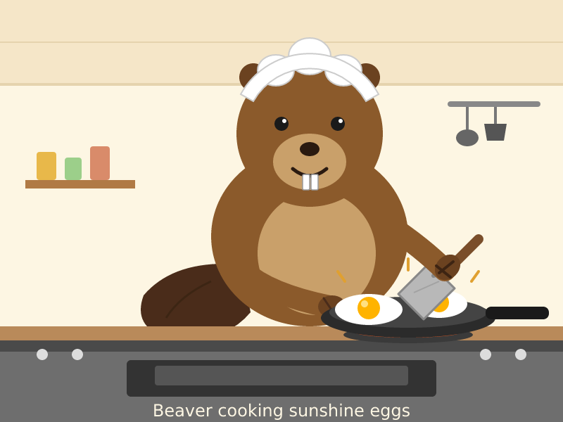 |

Feedback the refiner received for this round (from round 02): 5 defect(s) passed, 0 dropped

- **major** (contact): The beaver's flat tail floats in the air beside the body and is not joined to it _Where:_ left side, the dark oval tail. _Expected:_ The tail clearly attaches to the beaver's lower back or rump and comes out from behind the body
- **major** (shape): The spatula is just a plain grey rod with a rounded end and has no flat turner blade, so it is hard to recognise _Where:_ the utensil in the pan on the right. _Expected:_ The utensil reads clearly as a spatula, with a handle and a flat, wide blade resting under or beside an egg
- **minor** (contact): The beaver's paw only touches the middle of the spatula rod loosely, so it is unclear whether the beaver is gripping it _Where:_ the beaver's right paw at the spatula. _Expected:_ The paw clearly wraps around the spatula's handle
- **minor** (contact): The chef hat seems to sit on top of the head instead of fitting around it _Where:_ top of the beaver's head. _Expected:_ The hat band fits snugly around the top of the head
- **minor** (main): The beaver's body is cut off by the counter, and the left arm seems to rest on the counter without doing anything _Where:_ the beaver's lower body and left arm. _Expected:_ The beaver's pose clearly shows both paws taking part in the cooking or resting naturally

| | main | background | count | shape | contact | clean | color | total |
|---|---|---|---|---|---|---|---|---|
| reference, judgment | 4 | 4 | 5 | 4 | 4 | 4 | 5 | **30** |
| attempt, judgment | 4 | 5 | 5 | 3 | 4 | 3 | 5 | **29** |
| reference, confirmation (A/B swapped) | 4 | 4 | 5 | 4 | 3 | 4 | 5 | **29** |
| attempt, confirmation (A/B swapped) | 4 | 4 | 4 | 3 | 3 | 3 | 5 | **26** |

Judge: parity **yes**; confirmation: parity **no**. _No criterion differs by more than 1 point. The totals are A 30 and B 29, which differ by 1, and neither image has a critical defect, so all three parity conditions are met._

**Attempt defects (judge):**

- **major** (shape): The chef hat looks like a white crescent headband with puffs, not a tall chef's toque _Where:_ the top of the beaver's head. _Expected:_ The beaver wears a recognisable tall white chef's hat
- **major** (clean): The spatula blade is drawn on top of the second egg and covers most of it, so the egg looks cut off _Where:_ the spatula and the right egg in the pan. _Expected:_ Both eggs are clearly visible, and the spatula sits beside or slides under an egg
- **minor** (clean): Stray crossed dark lines lie over the paw that holds the spatula, which makes the grip look scribbled _Where:_ the beaver's right paw on the spatula handle. _Expected:_ The paw wraps cleanly around the handle with no stray marks
- **minor** (shape): The body is a huge round blob that fills much of the scene, and the head sits on it with almost no neck or shoulders _Where:_ the beaver's torso. _Expected:_ The beaver's body has readable shoulders and proportions that suit its head and arms
- **minor** (main): The beaver has no apron or other cooking outfit apart from the hat, so it reads less clearly as a chef _Where:_ the beaver's chest and belly. _Expected:_ The beaver clearly looks dressed as a cook

**Reference defects (judge, never shown to the refiner):**

- **minor** (shape): The arm holding the spatula is a very thin, stick-like line that does not match the beaver's chunky body _Where:_ the beaver's right arm reaching toward the pan. _Expected:_ The arm is as thick and rounded as the rest of the beaver's furry body
- **minor** (contact): The spatula blade floats in the air above the pan without touching the eggs or the pan _Where:_ the spatula over the frying pan. _Expected:_ The spatula blade rests on or slides under an egg in the pan
- **minor** (background): The big smiling sun in the window and the floating pink heart draw the eye away from the beaver and its cooking _Where:_ the upper left window and the space above the pan. _Expected:_ The background details stay quiet, so the beaver and the eggs are the focus
- **minor** (shape): The other arm is short and awkwardly bent, with a small round paw stuck to the side of the body _Where:_ the beaver's left arm. _Expected:_ The free arm hangs or rests naturally at the beaver's side
- **minor** (clean): The tail overlaps the feet and the floor line in a way that looks like a flat, cut-out shape _Where:_ the tail at the beaver's feet. _Expected:_ The tail sits clearly behind the beaver and comes out of its body

**My review:** **First judgment wrong, confirmation right.** This round is worse than round 02: the hat became a headband, the spatula covers an egg, and there are scribbled lines on the paw. The first judgment still called it parity (29 vs 30); the swapped confirmation said 26 vs 29 and stopped a false success.

---

### out-final-v3-beaver · round 04

| reference | attempt |
|---|---|
|  | 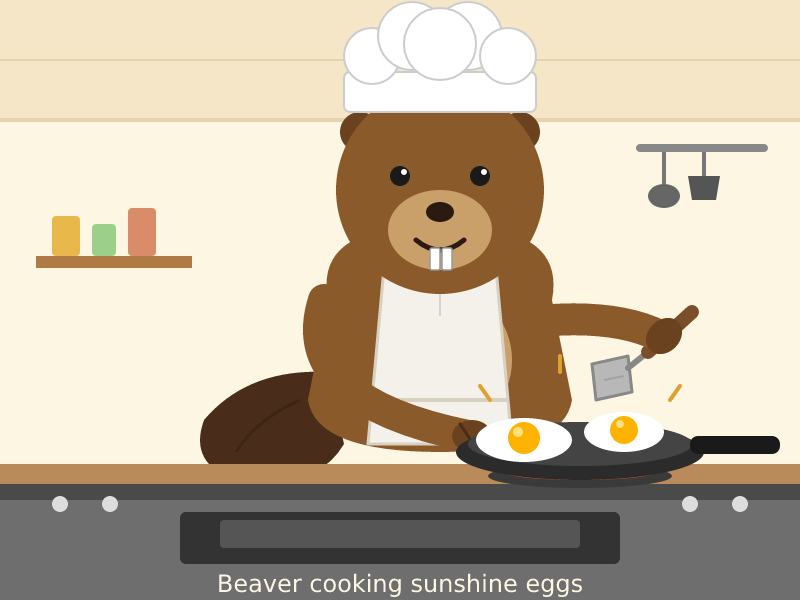 |

Feedback the refiner received for this round (from round 03): 5 defect(s) passed, 0 dropped

- **major** (shape): The chef hat looks like a white crescent headband with puffs, not a tall chef's toque _Where:_ the top of the beaver's head. _Expected:_ The beaver wears a recognisable tall white chef's hat
- **major** (clean): The spatula blade is drawn on top of the second egg and covers most of it, so the egg looks cut off _Where:_ the spatula and the right egg in the pan. _Expected:_ Both eggs are clearly visible, and the spatula sits beside or slides under an egg
- **minor** (clean): Stray crossed dark lines lie over the paw that holds the spatula, which makes the grip look scribbled _Where:_ the beaver's right paw on the spatula handle. _Expected:_ The paw wraps cleanly around the handle with no stray marks
- **minor** (shape): The body is a huge round blob that fills much of the scene, and the head sits on it with almost no neck or shoulders _Where:_ the beaver's torso. _Expected:_ The beaver's body has readable shoulders and proportions that suit its head and arms
- **minor** (main): The beaver has no apron or other cooking outfit apart from the hat, so it reads less clearly as a chef _Where:_ the beaver's chest and belly. _Expected:_ The beaver clearly looks dressed as a cook

| | main | background | count | shape | contact | clean | color | total |
|---|---|---|---|---|---|---|---|---|
| reference, judgment | 4 | 4 | 5 | 3 | 4 | 4 | 4 | **28** |
| attempt, judgment | 4 | 5 | 4 | 4 | 3 | 3 | 5 | **28** |
| reference, confirmation (A/B swapped) | 4 | 4 | 4 | 4 | 3 | 3 | 5 | **27** |
| attempt, confirmation (A/B swapped) | 4 | 4 | 4 | 3 | 3 | 3 | 5 | **26** |

Judge: parity **yes**; confirmation: parity **yes**. _No criterion differs by more than 1 (background, count, shape, contact, clean and color differ by 1; main is equal), both totals are 28, and neither image has a critical defect._

**Attempt defects (judge):**

- **major** (clean): The spatula is unclear: a brown stick points up and away from the fist, while a thin grey shaft runs down to a blade floating beside it, so it looks like two separate pieces _Where:_ the beaver's right hand above the pan. _Expected:_ One spatula with a single handle held in the fist, running straight to the blade
- **major** (contact): The spatula blade hangs in the air above the pan and does not touch the eggs or the pan _Where:_ above the right egg. _Expected:_ The spatula blade rests in the pan, touching or sliding under an egg
- **minor** (contact): The frying pan sits on a wooden counter edge, not on a burner, so it is unclear how the eggs are cooking _Where:_ the pan at lower right. _Expected:_ The pan sits clearly on a stove burner
- **minor** (shape): The reaching arm is stretched very long and thin compared with the body _Where:_ the beaver's right arm. _Expected:_ The arm is in proportion with the beaver's chunky body
- **minor** (clean): A stray vertical line runs down the middle of the apron _Where:_ the apron front. _Expected:_ A clean apron without unexplained lines

**Reference defects (judge, never shown to the refiner):**

- **major** (shape): The arm holding the spatula is an extremely long, thin, noodle-like stretch _Where:_ the beaver's right arm reaching to the pan. _Expected:_ A thicker, shorter arm in proportion with the beaver's body
- **minor** (contact): The pan is drawn over the back of the stove and does not clearly sit on a burner _Where:_ the pan on the stove top. _Expected:_ The pan sits squarely on a burner
- **minor** (background): The big smiling sun in the window and the floating heart compete for attention with the beaver _Where:_ upper left window and above the pan. _Expected:_ Background details stay quieter than the beaver and the eggs
- **minor** (color): The caption is pale brown on a brown wood floor and hard to read _Where:_ bottom caption. _Expected:_ The caption contrasts clearly with the floor

**My review:** **Defensible (parity, confirmed).** Clean and readable, with an apron and the hat fixed, but the spatula is still disconnected from the paw. The reference is richer (window with a smiling sun, sun apron, burners). The reference scored lower here (28 and 27) than in earlier rounds (30 and 31), which helped the parity: a borderline call.

---

## out-final-v3-santa

Prompt: _Generate an SVG of Santa claus holding presents on a scooter_  
Stop: **round_cap** after round 5, final = round 3, total $0.6897

### out-final-v3-santa · round 00

| reference | attempt |
|---|---|
| 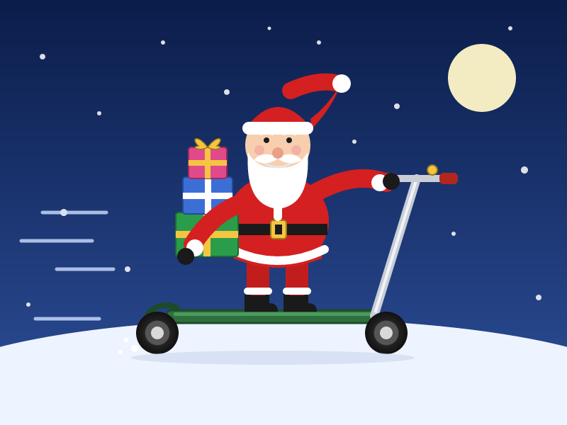 | 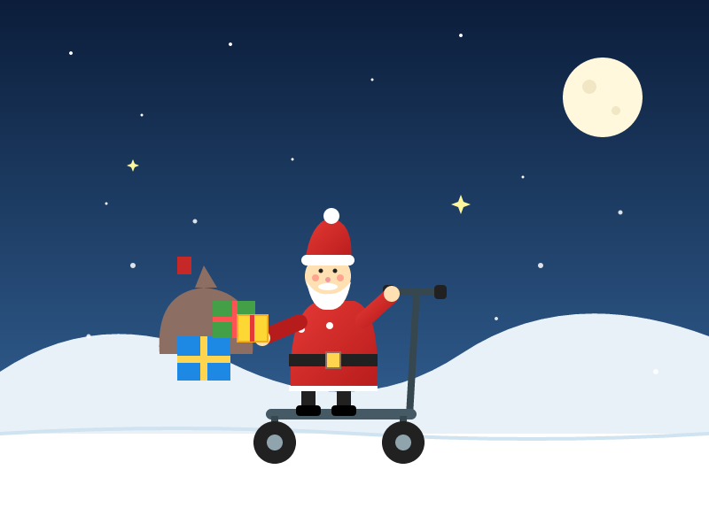 |

| | main | background | count | shape | contact | clean | color | total |
|---|---|---|---|---|---|---|---|---|
| reference, judgment | 5 | 5 | 5 | 4 | 4 | 4 | 5 | **32** |
| attempt, judgment | 4 | 5 | 5 | 3 | 3 | 3 | 5 | **28** |

Judge: parity **no**. _The totals are A 28 and B 32, a gap of 4, which breaks the totals rule, and shape, contact and clean each differ by only 1. Neither image has a critical defect, but parity fails on the totals._

**Attempt defects (judge):**

- **major** (contact): The gift sack and the two presents in front of it hang in the air behind Santa and are not attached to him or the scooter _Where:_ left of Santa, behind his raised arm. _Expected:_ The sack and presents should rest on the scooter deck, sit on Santa's back, or be clearly held, so they travel with him
- **major** (clean): A loose red square floats above the sack and isn't connected to anything _Where:_ above the brown sack, middle left. _Expected:_ No stray shapes; any tie or decoration should be visibly attached to the sack
- **minor** (clean): The green and yellow presents overlap each other, the sack and Santa's arm in a cluttered pile _Where:_ around Santa's left hand. _Expected:_ Each present should sit in its own clear place, either in his hand or on the sack, without tangled overlaps
- **minor** (shape): Santa's legs are very short stubs under a boxy body, so the figure looks squashed _Where:_ Santa's legs and lower body. _Expected:_ Santa should have legs of believable length for a standing rider
- **minor** (contact): The hand on the handlebar sits just below the grip instead of clearly wrapping around it _Where:_ Santa's right hand at the top of the scooter stem. _Expected:_ The hand should clearly grip the handlebar

**Reference defects (judge, never shown to the refiner):**

- **minor** (contact): The stack of presents hovers beside Santa and is only touched at one bottom corner by his hand, so it looks like it is floating _Where:_ the present stack left of Santa. _Expected:_ The presents should be clearly held from underneath or rest on the scooter deck
- **minor** (shape): The hat's tail flies up in a long, thin, wavy streamer that looks more like a ribbon than a hat _Where:_ top of Santa's hat. _Expected:_ The hat should have a natural floppy tip with its pom-pom close to the hat
- **minor** (clean): The present stack overlaps Santa's arm and body edge, which muddles the outline _Where:_ Santa's left side. _Expected:_ The presents and Santa's arm should have clearly separate outlines

**My review:** **Right (no parity).** Santa holds one small present; the others sit on a sack that floats beside the scooter. The reference holds a stack of presents in one arm. Clearly behind.

---

### out-final-v3-santa · round 01

| reference | attempt |
|---|---|
|  | 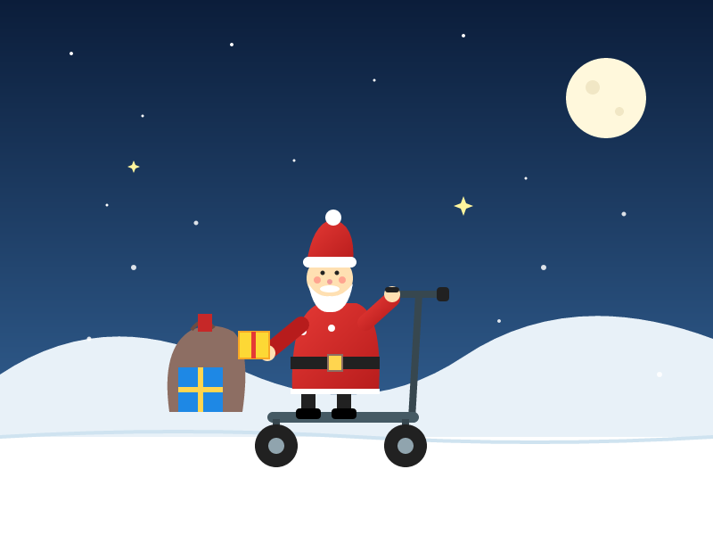 |

Feedback the refiner received for this round (from round 00): 5 defect(s) passed, 0 dropped

- **major** (contact): The gift sack and the two presents in front of it hang in the air behind Santa and are not attached to him or the scooter _Where:_ left of Santa, behind his raised arm. _Expected:_ The sack and presents should rest on the scooter deck, sit on Santa's back, or be clearly held, so they travel with him
- **major** (clean): A loose red square floats above the sack and isn't connected to anything _Where:_ above the brown sack, middle left. _Expected:_ No stray shapes; any tie or decoration should be visibly attached to the sack
- **minor** (clean): The green and yellow presents overlap each other, the sack and Santa's arm in a cluttered pile _Where:_ around Santa's left hand. _Expected:_ Each present should sit in its own clear place, either in his hand or on the sack, without tangled overlaps
- **minor** (shape): Santa's legs are very short stubs under a boxy body, so the figure looks squashed _Where:_ Santa's legs and lower body. _Expected:_ Santa should have legs of believable length for a standing rider
- **minor** (contact): The hand on the handlebar sits just below the grip instead of clearly wrapping around it _Where:_ Santa's right hand at the top of the scooter stem. _Expected:_ The hand should clearly grip the handlebar

| | main | background | count | shape | contact | clean | color | total |
|---|---|---|---|---|---|---|---|---|
| reference, judgment | 4 | 5 | 5 | 4 | 3 | 4 | 5 | **30** |
| attempt, judgment | 4 | 4 | 5 | 3 | 4 | 3 | 5 | **28** |

Judge: parity **no**. _A scores 30 and B scores 28, so the totals differ by 2, which is more than the allowed 1. No single criterion differs by more than 1 and neither image has a critical defect, but the total gap alone breaks parity._

**Attempt defects (judge):**

- **major** (clean): The blue present is a flat square stuck onto the front of the sack, so it reads as a sticker rather than a gift inside or beside the sack _Where:_ the gift sack at left. _Expected:_ The present should look like it is poking out of the sack's opening or sitting next to it as a separate object
- **major** (shape): The sack is a stiff, blocky shape with a square red knot on top and does not look like a soft bag full of toys _Where:_ the brown sack at left. _Expected:_ The sack should have a rounded, lumpy, cloth-like shape tied at the neck
- **minor** (contact): The sack sits on the far hill, apart from the scooter, so it does not seem to travel with Santa _Where:_ the sack behind the scooter. _Expected:_ The sack should ride on the scooter deck or be slung over Santa's shoulder
- **minor** (shape): Santa's arms are thin sticks and his body is a plain rectangle, so the figure looks stiff _Where:_ Santa's arms and torso. _Expected:_ Santa should have rounder, fuller arms and a belly that looks plump
- **minor** (background): The hill line behind runs right through the sack, so the sack seems to be sinking into the background _Where:_ left middle, around the sack. _Expected:_ The sack should sit clearly on the ground in front of the hills

**Reference defects (judge, never shown to the refiner):**

- **major** (contact): The stack of three presents hangs in mid-air above the scooter deck, and Santa's gloved hand only crosses in front of it without holding it _Where:_ left side, the gift stack behind Santa. _Expected:_ The presents should clearly rest on the scooter deck or be held firmly in Santa's arm or hand
- **minor** (shape): The hat's tip is a very long, thin curling ribbon that rises well above the head and looks more like a streamer than part of a hat _Where:_ top of Santa's hat. _Expected:_ The hat should end in a believable floppy tip with a pom-pom, close to the head
- **minor** (shape): The torso is very large while the legs are short and stubby, so the body looks top-heavy _Where:_ Santa's body and legs. _Expected:_ Santa should keep a round belly but have legs long enough to stand naturally on the deck
- **minor** (clean): Santa's red arm sleeve runs across the front of the gift stack, so the two shapes overlap awkwardly _Where:_ Santa's left arm over the presents. _Expected:_ The arm should either clearly hold the gifts or sit apart from them without a messy overlap

**My review:** **Right (no parity).** A small change only: the sack moved and still floats off the scooter.

---

### out-final-v3-santa · round 02

| reference | attempt |
|---|---|
|  | 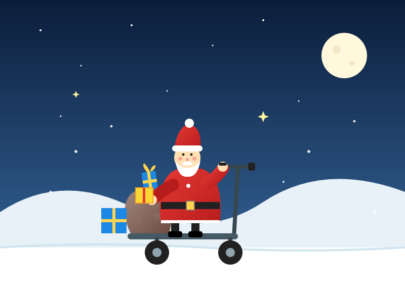 |

Feedback the refiner received for this round (from round 01): 5 defect(s) passed, 0 dropped

- **major** (clean): The blue present is a flat square stuck onto the front of the sack, so it reads as a sticker rather than a gift inside or beside the sack _Where:_ the gift sack at left. _Expected:_ The present should look like it is poking out of the sack's opening or sitting next to it as a separate object
- **major** (shape): The sack is a stiff, blocky shape with a square red knot on top and does not look like a soft bag full of toys _Where:_ the brown sack at left. _Expected:_ The sack should have a rounded, lumpy, cloth-like shape tied at the neck
- **minor** (contact): The sack sits on the far hill, apart from the scooter, so it does not seem to travel with Santa _Where:_ the sack behind the scooter. _Expected:_ The sack should ride on the scooter deck or be slung over Santa's shoulder
- **minor** (shape): Santa's arms are thin sticks and his body is a plain rectangle, so the figure looks stiff _Where:_ Santa's arms and torso. _Expected:_ Santa should have rounder, fuller arms and a belly that looks plump
- **minor** (background): The hill line behind runs right through the sack, so the sack seems to be sinking into the background _Where:_ left middle, around the sack. _Expected:_ The sack should sit clearly on the ground in front of the hills

| | main | background | count | shape | contact | clean | color | total |
|---|---|---|---|---|---|---|---|---|
| reference, judgment | 4 | 5 | 5 | 4 | 3 | 4 | 5 | **30** |
| attempt, judgment | 4 | 5 | 4 | 3 | 3 | 4 | 5 | **28** |

Judge: parity **no**. _Every per-criterion score differs by at most 1 and neither image has a critical defect, but the totals differ by 2 (A 28, B 30), so condition 2 fails._

**Attempt defects (judge):**

- **major** (shape): Santa's legs are tiny stubs under a large, boxy torso, so he looks squat and is hard to read as standing on the scooter _Where:_ Santa's legs and lower body. _Expected:_ Santa has legs long enough to look like he is standing upright on the scooter deck, with believable body proportions
- **major** (contact): Santa's raised hand stops short of the handlebar grip and seems to float near the stem instead of steering _Where:_ Santa's right hand and the top of the scooter handlebar. _Expected:_ Santa's hand clearly grips the handlebar so he is visibly steering the scooter
- **minor** (contact): The blue present on the left floats beside the sack with nothing holding it, and the small gifts on top of the sack sit loosely _Where:_ left side of the scooter deck, around the sack. _Expected:_ All presents rest on the deck, inside the sack or in Santa's grip so none appear to float
- **minor** (clean): Santa's left arm overlaps the sack and the gifts in a cluttered pile, so it is unclear what he is holding _Where:_ Santa's left arm and the sack. _Expected:_ Santa's arm, the sack and the presents read as separate, clearly arranged shapes
- **minor** (main): Santa and the scooter are small in the frame, leaving the main action less prominent than the empty sky _Where:_ lower middle of the picture. _Expected:_ Santa on the scooter fills more of the picture as the clear focus

**Reference defects (judge, never shown to the refiner):**

- **major** (contact): The stack of presents hovers in the air beside Santa; his lower hand sits beneath it but does not really hold it, and it does not rest on the deck _Where:_ the gift stack on the left of Santa. _Expected:_ The presents are clearly held in Santa's arm or rest on the scooter deck
- **minor** (shape): The hat's tip curls up and away in a long, stiff hook that looks detached from the hat _Where:_ Santa's hat, upper right of his head. _Expected:_ The hat tip flows naturally from the hat, like fabric blown back by the wind
- **minor** (clean): Santa's lower arm curves around behind the gift stack and ends in a mitten that looks pasted on beside the stack _Where:_ Santa's left arm and hand near the presents. _Expected:_ The arm and hand join the presents in a clear, purposeful way
- **minor** (shape): Santa's torso is very wide compared with his straight, narrow legs _Where:_ Santa's body and legs. _Expected:_ Santa's torso and legs look balanced and believable as a cartoon figure

**My review:** **Right (no parity).** The sack is now on the deck, but it overlaps Santa and the presents and becomes cluttered.

---

### out-final-v3-santa · round 03

| reference | attempt |
|---|---|
|  | 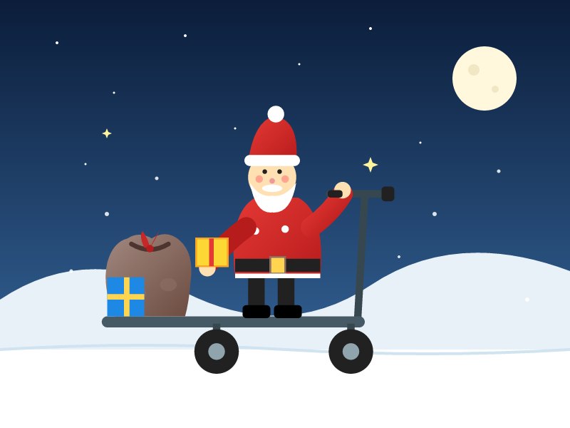 |

Feedback the refiner received for this round (from round 02): 5 defect(s) passed, 0 dropped

- **major** (shape): Santa's legs are tiny stubs under a large, boxy torso, so he looks squat and is hard to read as standing on the scooter _Where:_ Santa's legs and lower body. _Expected:_ Santa has legs long enough to look like he is standing upright on the scooter deck, with believable body proportions
- **major** (contact): Santa's raised hand stops short of the handlebar grip and seems to float near the stem instead of steering _Where:_ Santa's right hand and the top of the scooter handlebar. _Expected:_ Santa's hand clearly grips the handlebar so he is visibly steering the scooter
- **minor** (contact): The blue present on the left floats beside the sack with nothing holding it, and the small gifts on top of the sack sit loosely _Where:_ left side of the scooter deck, around the sack. _Expected:_ All presents rest on the deck, inside the sack or in Santa's grip so none appear to float
- **minor** (clean): Santa's left arm overlaps the sack and the gifts in a cluttered pile, so it is unclear what he is holding _Where:_ Santa's left arm and the sack. _Expected:_ Santa's arm, the sack and the presents read as separate, clearly arranged shapes
- **minor** (main): Santa and the scooter are small in the frame, leaving the main action less prominent than the empty sky _Where:_ lower middle of the picture. _Expected:_ Santa on the scooter fills more of the picture as the clear focus

| | main | background | count | shape | contact | clean | color | total |
|---|---|---|---|---|---|---|---|---|
| reference, judgment | 4 | 5 | 5 | 4 | 3 | 4 | 5 | **30** |
| attempt, judgment | 4 | 5 | 5 | 4 | 4 | 4 | 5 | **31** |
| reference, confirmation (A/B swapped) | 5 | 5 | 5 | 4 | 4 | 4 | 5 | **32** |
| attempt, confirmation (A/B swapped) | 4 | 5 | 5 | 3 | 3 | 3 | 5 | **28** |

Judge: parity **yes**; confirmation: parity **no**. _No criterion differs by more than 1 point, the totals are 31 and 30 (a difference of 1), and neither image has a critical defect, so parity holds._

**Attempt defects (judge):**

- **minor** (shape): The scooter deck is very long and wide, so it looks more like a flat cart than a kick scooter _Where:_ the scooter deck. _Expected:_ The deck is sized like a scooter deck, just long enough for the rider and his sack
- **minor** (contact): Santa's body faces the viewer instead of the direction he is riding _Where:_ Santa's torso and legs. _Expected:_ Santa's body is turned toward the handlebar and the direction of travel
- **minor** (shape): Santa's head and hat are big compared with his short torso and stubby legs _Where:_ Santa's figure. _Expected:_ Santa's head, body and legs look balanced for a cartoon figure
- **minor** (clean): The present in Santa's hand sits at an awkward angle and overlaps his arm, so it is hard to see how he grips it _Where:_ Santa's left hand and the present. _Expected:_ The present is clearly held in Santa's hand

**Reference defects (judge, never shown to the refiner):**

- **major** (contact): The stack of presents floats in the air next to Santa; it is not held and does not rest on the deck _Where:_ the gift stack on the left of Santa. _Expected:_ The presents are clearly carried by Santa or sit firmly on the scooter deck
- **minor** (clean): Santa's outstretched arm cuts across the bottom present, so the shapes overlap untidily _Where:_ Santa's left arm and the green present. _Expected:_ The arm and the presents are layered so that it is clear which is in front
- **minor** (shape): The hat's tail is very long and rigid and sticks up and back like a horn _Where:_ the top of Santa's hat. _Expected:_ The hat tail flops or flutters naturally behind Santa's head

**My review:** **First judgment wrong, confirmation right.** The first judgment put the attempt above the reference (31 vs 30). It is not: Santa still holds a single present while the reference holds a stack, and the reference is more finished. The swapped confirmation said 28 vs 32. The biggest noise in the final runs: 5 points on the same pair.

---

### out-final-v3-santa · round 04

| reference | attempt |
|---|---|
|  | 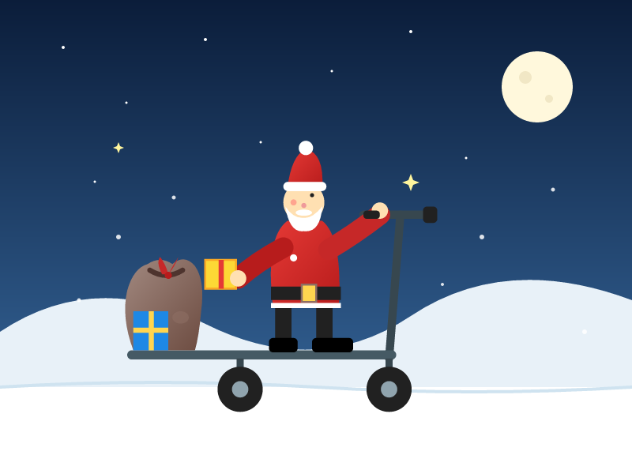 |

Feedback the refiner received for this round (from round 03): 4 defect(s) passed, 0 dropped

- **minor** (shape): The scooter deck is very long and wide, so it looks more like a flat cart than a kick scooter _Where:_ the scooter deck. _Expected:_ The deck is sized like a scooter deck, just long enough for the rider and his sack
- **minor** (contact): Santa's body faces the viewer instead of the direction he is riding _Where:_ Santa's torso and legs. _Expected:_ Santa's body is turned toward the handlebar and the direction of travel
- **minor** (shape): Santa's head and hat are big compared with his short torso and stubby legs _Where:_ Santa's figure. _Expected:_ Santa's head, body and legs look balanced for a cartoon figure
- **minor** (clean): The present in Santa's hand sits at an awkward angle and overlaps his arm, so it is hard to see how he grips it _Where:_ Santa's left hand and the present. _Expected:_ The present is clearly held in Santa's hand

| | main | background | count | shape | contact | clean | color | total |
|---|---|---|---|---|---|---|---|---|
| reference, judgment | 5 | 5 | 5 | 4 | 4 | 4 | 5 | **32** |
| attempt, judgment | 4 | 5 | 5 | 3 | 3 | 3 | 5 | **28** |

Judge: parity **no**. _Each criterion differs by at most 1 and neither image has a critical defect, but the totals are 32 for A and 28 for B, a gap of 4, so rule 2 fails._

**Attempt defects (judge):**

- **major** (contact): A loose black shape sits next to Santa's bare hand at the handlebar, so the hand does not clearly grip the bar. _Where:_ Santa's hand at the top of the scooter handlebar. _Expected:_ Santa's hand, gloved or bare, visibly wraps around the handlebar grip.
- **major** (shape): The scooter deck sticks out far behind the rear wheel, and the rear wheel sits near the middle of the deck, so the scooter looks unbalanced. _Where:_ the scooter deck and rear wheel. _Expected:_ The rear wheel sits near the back end of the deck, like a normal scooter.
- **minor** (shape): The toy sack is a lumpy brown blob that is hard to recognise as a tied sack. _Where:_ the sack at the back of the deck. _Expected:_ The sack reads clearly as a full cloth bag tied at the top.
- **minor** (main): Santa's face is small and shows only one eye, so his expression is hard to read. _Where:_ Santa's head. _Expected:_ Santa's face is clearly readable, with visible eyes and a cheerful look.
- **minor** (clean): A small white dot floats on Santa's coat sleeve near the shoulder with no clear purpose. _Where:_ Santa's upper arm. _Expected:_ No stray marks on the coat; any trim or buttons are clearly placed.

**Reference defects (judge, never shown to the refiner):**

- **minor** (contact): The stack of presents hangs in the air beside Santa and is held only by its bottom corner, so it does not look supported. _Where:_ the gift stack on the left of Santa. _Expected:_ Santa's hand clearly grips or supports the presents, or the presents rest on the scooter deck.
- **minor** (shape): The arm holding the handlebar is very long and stretches out like a rubber hose to reach the bar. _Where:_ Santa's right arm reaching the handlebar. _Expected:_ The arm has a believable length, with Santa standing close enough to the handlebar to hold it.
- **minor** (clean): The white mustache is a flat band across the face that covers the lower cheeks and looks pasted on. _Where:_ Santa's face, below the nose. _Expected:_ The mustache blends naturally into the beard and face.

**My review:** **Right (no parity).** A cleaner drawing, but stiff block legs, and "holding presents" is still one small box.

---

### out-final-v3-santa · round 05

| reference | attempt |
|---|---|
|  | 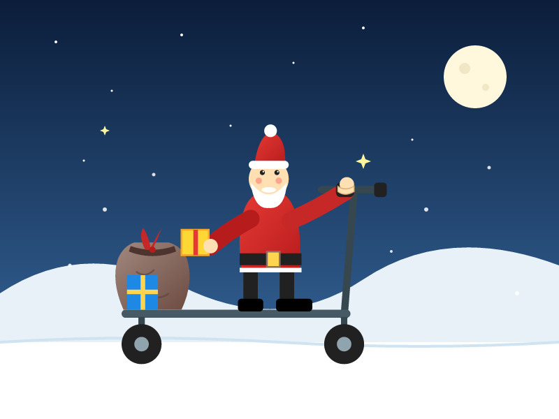 |

Feedback the refiner received for this round (from round 04): 5 defect(s) passed, 0 dropped

- **major** (contact): A loose black shape sits next to Santa's bare hand at the handlebar, so the hand does not clearly grip the bar. _Where:_ Santa's hand at the top of the scooter handlebar. _Expected:_ Santa's hand, gloved or bare, visibly wraps around the handlebar grip.
- **major** (shape): The scooter deck sticks out far behind the rear wheel, and the rear wheel sits near the middle of the deck, so the scooter looks unbalanced. _Where:_ the scooter deck and rear wheel. _Expected:_ The rear wheel sits near the back end of the deck, like a normal scooter.
- **minor** (shape): The toy sack is a lumpy brown blob that is hard to recognise as a tied sack. _Where:_ the sack at the back of the deck. _Expected:_ The sack reads clearly as a full cloth bag tied at the top.
- **minor** (main): Santa's face is small and shows only one eye, so his expression is hard to read. _Where:_ Santa's head. _Expected:_ Santa's face is clearly readable, with visible eyes and a cheerful look.
- **minor** (clean): A small white dot floats on Santa's coat sleeve near the shoulder with no clear purpose. _Where:_ Santa's upper arm. _Expected:_ No stray marks on the coat; any trim or buttons are clearly placed.

| | main | background | count | shape | contact | clean | color | total |
|---|---|---|---|---|---|---|---|---|
| reference, judgment | 5 | 5 | 5 | 4 | 4 | 4 | 5 | **32** |
| attempt, judgment | 4 | 5 | 5 | 3 | 4 | 4 | 5 | **30** |

Judge: parity **no**. _No criterion differs by more than 1 and neither image has a critical defect, but the totals are A 32 and B 30. That difference of 2 is more than 1, so the images are not at parity._

**Attempt defects (judge):**

- **major** (shape): Santa's body is built from stiff, narrow rectangles, with thin straight legs and arms, so he looks thin and wooden instead of round and jolly _Where:_ Santa's torso, arms and legs. _Expected:_ Santa has a rounded, plump body and natural limbs, so he reads at once as a jolly Santa
- **minor** (main): Santa's face and beard are small compared to his body, which makes the character harder to recognise _Where:_ Santa's head. _Expected:_ A fuller white beard and a face in proportion, so Santa is instantly recognisable
- **minor** (clean): The blue gift sits flat on the front of the sack and reads as a sticker more than a present inside the sack or beside it _Where:_ the sack at the back of the deck. _Expected:_ The gift clearly sticks out of the sack's opening or stands next to it
- **minor** (contact): The steering post is not clearly joined to the front of the deck, so the front of the scooter looks loosely put together _Where:_ the front of the scooter, where the post meets the deck and wheel. _Expected:_ The steering post clearly connects the handlebar, the deck and the front wheel as one sturdy scooter

**Reference defects (judge, never shown to the refiner):**

- **minor** (contact): The stack of gifts seems to float beside Santa, and only the lowest box touches his gloved hand _Where:_ the gift stack on the left of Santa. _Expected:_ The gifts look clearly carried, either held firmly against his body or resting on the scooter deck
- **minor** (shape): The hat's tip shoots high up and back in a long, stiff curve, so it looks like a hook more than a floppy hat _Where:_ the top of Santa's hat. _Expected:_ The hat tip droops or trails naturally behind his head
- **minor** (clean): A small dark curved shape sticks up from the back end of the deck and is hard to identify _Where:_ above the rear wheel. _Expected:_ The rear of the scooter reads clearly as a fender or brake, or the stray shape is gone

**My review:** **Right (no parity).** A hand now grips the handlebar. Still one present in hand and the rest in a sack, so it stays behind the reference. The run ended at the round cap; the final SVG is round 03, the best total, even though the confirmation rejected it.

---

## out-final-v3-monkey

Prompt: _Generate an SVG of a monkey climbing an apple tree_  
Stop: **stagnation** after round 3, final = round 1, total $0.4298

### out-final-v3-monkey · round 00

| reference | attempt |
|---|---|
| 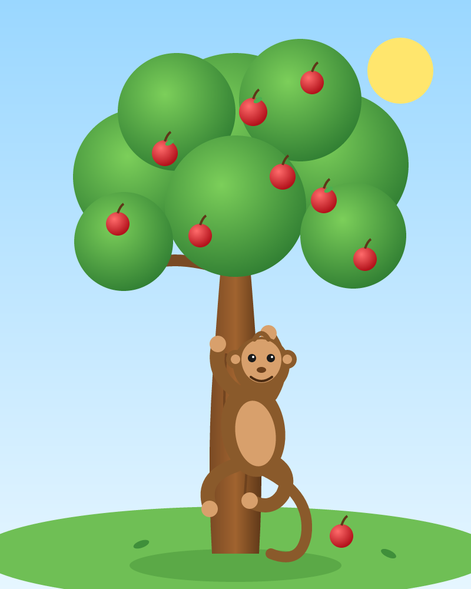 | 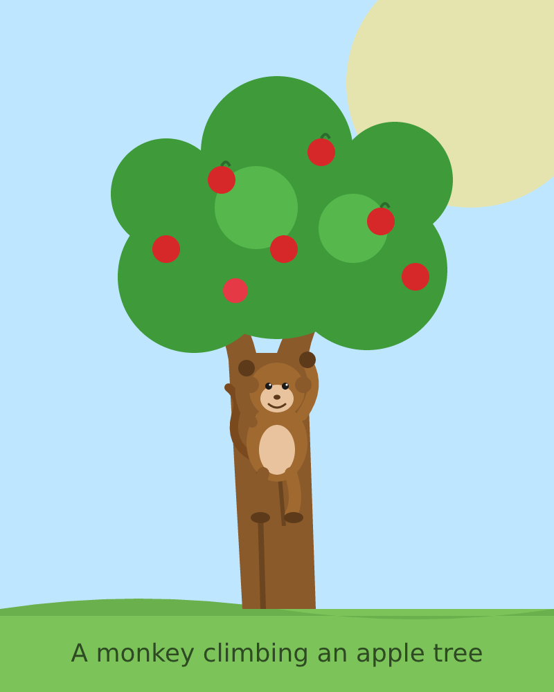 |

| | main | background | count | shape | contact | clean | color | total |
|---|---|---|---|---|---|---|---|---|
| reference, judgment | 5 | 5 | 4 | 4 | 4 | 4 | 5 | **31** |
| attempt, judgment | 3 | 3 | 3 | 2 | 3 | 2 | 4 | **20** |

Judge: parity **no**. _Shape differs by 2 (4 vs 2) and clean by 2 (4 vs 2), and the totals differ by 11 (31 vs 20), so conditions 1 and 2 fail even though neither image has a critical defect._

**Attempt defects (judge):**

- **major** (shape): The monkey's arms, ears and hands blend into one shapeless mass around the head, with dark balls for hands that look like extra ears _Where:_ the monkey's head and raised arms. _Expected:_ Ears, arms and hands should be separate and recognisable, with the arms clearly reaching up the trunk
- **major** (count): The legs are thin sticks ending in dark ovals and blend into a stray line on the trunk, so you can't count the legs and tail _Where:_ the monkey's lower body and the trunk below it. _Expected:_ Two clear legs gripping the trunk and one clearly visible tail
- **major** (clean): Stray dark lines and blobs run down the trunk below the monkey and look like broken pieces _Where:_ the middle of the trunk under the monkey. _Expected:_ The trunk should be clean, and only the monkey's own limbs should show on it
- **minor** (background): A huge pale sun is cut off at the edge and fills much of the upper right, so it competes with the tree _Where:_ upper right sky. _Expected:_ A smaller sun that sits fully in the sky and stays in the background
- **minor** (contact): The monkey's hands and feet don't clearly hold the trunk; the feet sit as flat ovals on its surface _Where:_ the monkey's hands and feet. _Expected:_ Hands and feet should visibly wrap around and grip the trunk

**Reference defects (judge, never shown to the refiner):**

- **minor** (shape): The legs are drawn as thick round loops, so they look like rings more than bent limbs gripping the trunk _Where:_ the monkey's lower body and legs. _Expected:_ The legs should read clearly as bent legs wrapped around the trunk, with knees and feet you can tell apart
- **minor** (count): Hard to tell which loop is a leg and which is the tail, so the monkey seems to have one leg too few or too many _Where:_ the monkey's hips, legs and tail. _Expected:_ Two legs and one tail should be easy to pick out on their own
- **minor** (contact): The raised hand above the head floats beside the trunk instead of clearly gripping it _Where:_ the monkey's upper raised hand. _Expected:_ Both hands should visibly grip the trunk or a branch as the monkey climbs
- **minor** (clean): The leg loops and tail cross over each other and the trunk edge, which looks a bit tangled _Where:_ the base of the trunk around the monkey's legs. _Expected:_ The limbs and tail should overlap neatly so their outlines stay clear

**My review:** **Right (no parity).** The monkey hangs flat on the trunk with unclear limbs, and a huge pale sun is cut by the edge. The reference is far better.

---

### out-final-v3-monkey · round 01

| reference | attempt |
|---|---|
|  | 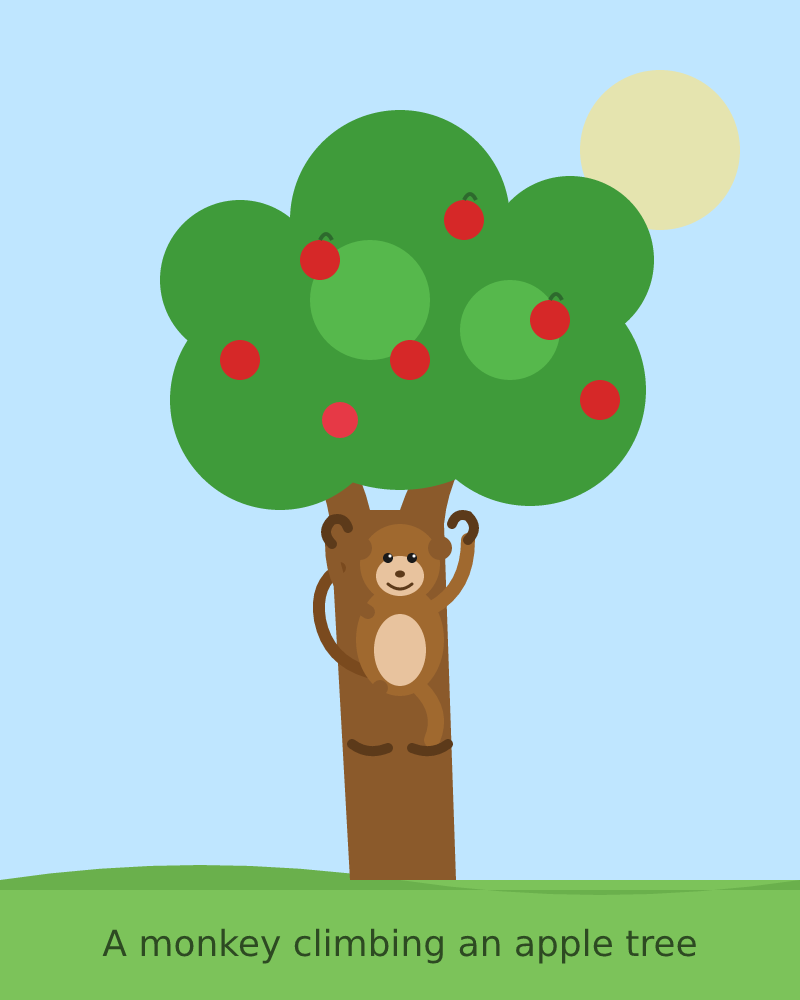 |

Feedback the refiner received for this round (from round 00): 5 defect(s) passed, 0 dropped

- **major** (shape): The monkey's arms, ears and hands blend into one shapeless mass around the head, with dark balls for hands that look like extra ears _Where:_ the monkey's head and raised arms. _Expected:_ Ears, arms and hands should be separate and recognisable, with the arms clearly reaching up the trunk
- **major** (count): The legs are thin sticks ending in dark ovals and blend into a stray line on the trunk, so you can't count the legs and tail _Where:_ the monkey's lower body and the trunk below it. _Expected:_ Two clear legs gripping the trunk and one clearly visible tail
- **major** (clean): Stray dark lines and blobs run down the trunk below the monkey and look like broken pieces _Where:_ the middle of the trunk under the monkey. _Expected:_ The trunk should be clean, and only the monkey's own limbs should show on it
- **minor** (background): A huge pale sun is cut off at the edge and fills much of the upper right, so it competes with the tree _Where:_ upper right sky. _Expected:_ A smaller sun that sits fully in the sky and stays in the background
- **minor** (contact): The monkey's hands and feet don't clearly hold the trunk; the feet sit as flat ovals on its surface _Where:_ the monkey's hands and feet. _Expected:_ Hands and feet should visibly wrap around and grip the trunk

| | main | background | count | shape | contact | clean | color | total |
|---|---|---|---|---|---|---|---|---|
| reference, judgment | 4 | 5 | 4 | 4 | 4 | 4 | 5 | **30** |
| attempt, judgment | 3 | 4 | 3 | 3 | 2 | 2 | 4 | **21** |

Judge: parity **no**. _Image A totals 30 and image B totals 21, a gap well over 1, and contact (4 vs 2) and clean (4 vs 2) each differ by 2. Neither image has a critical defect, but conditions 1 and 2 fail._

**Attempt defects (judge):**

- **major** (contact): Both raised arms end in curled hooks in the open air beside the trunk, and neither one grips the tree. _Where:_ the monkey's arms and hands. _Expected:_ The monkey's hands should wrap around the trunk or a branch so it clearly looks like it is climbing.
- **major** (clean): The feet are separate dark dashes with nothing joining them to the legs, and there are extra curved limb shapes, so it is unclear which shapes are legs and which is the tail. _Where:_ the monkey's lower body and both sides of its torso. _Expected:_ Two legs should be clearly joined to the body and end in feet, with one tail that is easy to tell apart from them.
- **major** (count): The monkey seems to have extra limbs: two hooked arms, a long curve on the left and a hanging curve below, which do not add up to a clear two arms, two legs and a tail. _Where:_ around the monkey's body. _Expected:_ The monkey should have two arms, two legs and one tail, each easy to recognise.
- **minor** (main): Several apples have no stems, and one apple is a paler pink than the others, so it looks out of place. _Where:_ the apples in the tree canopy. _Expected:_ All the apples should look alike and clearly read as apples hanging in the tree.
- **minor** (color): The sun is a washed-out cream colour that almost disappears into the pale sky. _Where:_ upper right. _Expected:_ The sun should be clearly visible against the sky.

**Reference defects (judge, never shown to the refiner):**

- **minor** (clean): One raised hand sits behind the top of the monkey's head, so it looks like a bump on the head instead of a hand. _Where:_ top of the monkey's head. _Expected:_ Both raised hands should be clearly separate from the head and visibly gripping the trunk.
- **minor** (shape): The legs are drawn as one looping curve, so it is hard to tell the two legs apart. _Where:_ the monkey's lower body and legs. _Expected:_ Two distinct legs should bend around the trunk, each ending in a foot.
- **minor** (contact): The feet float slightly to either side of the trunk instead of pressing against it. _Where:_ the monkey's feet near the bottom of the trunk. _Expected:_ The feet should rest firmly against the trunk, as a climber's would.

**My review:** **Right (no parity).** The sun is fixed, but the arms end in curled hooks in the air and do not grip the tree. The judge named it exactly.

---

### out-final-v3-monkey · round 02

| reference | attempt |
|---|---|
|  | 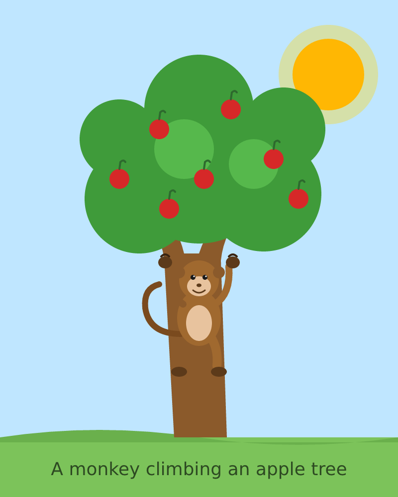 |

Feedback the refiner received for this round (from round 01): 5 defect(s) passed, 0 dropped

- **major** (contact): Both raised arms end in curled hooks in the open air beside the trunk, and neither one grips the tree. _Where:_ the monkey's arms and hands. _Expected:_ The monkey's hands should wrap around the trunk or a branch so it clearly looks like it is climbing.
- **major** (clean): The feet are separate dark dashes with nothing joining them to the legs, and there are extra curved limb shapes, so it is unclear which shapes are legs and which is the tail. _Where:_ the monkey's lower body and both sides of its torso. _Expected:_ Two legs should be clearly joined to the body and end in feet, with one tail that is easy to tell apart from them.
- **major** (count): The monkey seems to have extra limbs: two hooked arms, a long curve on the left and a hanging curve below, which do not add up to a clear two arms, two legs and a tail. _Where:_ around the monkey's body. _Expected:_ The monkey should have two arms, two legs and one tail, each easy to recognise.
- **minor** (main): Several apples have no stems, and one apple is a paler pink than the others, so it looks out of place. _Where:_ the apples in the tree canopy. _Expected:_ All the apples should look alike and clearly read as apples hanging in the tree.
- **minor** (color): The sun is a washed-out cream colour that almost disappears into the pale sky. _Where:_ upper right. _Expected:_ The sun should be clearly visible against the sky.

| | main | background | count | shape | contact | clean | color | total |
|---|---|---|---|---|---|---|---|---|
| reference, judgment | 4 | 5 | 4 | 4 | 4 | 4 | 5 | **30** |
| attempt, judgment | 3 | 4 | 3 | 3 | 2 | 2 | 4 | **21** |

Judge: parity **no**. _Contact differs by 2 (4 vs 2) and clean differs by 2 (4 vs 2), and the totals differ by 9 (29 vs 20), so conditions 1 and 2 fail._

**Attempt defects (judge):**

- **major** (contact): The two dark brown hand blobs float above the monkey at the base of the leaves and connect to no arm. _Where:_ just under the canopy, above the monkey. _Expected:_ Each hand sits at the end of an arm and grips the trunk or a branch.
- **major** (count): There is only one clear arm, and one leg is missing. The feet are loose dark ovals that are detached from the body. _Where:_ the monkey's arms and legs. _Expected:_ The monkey has two arms and two legs, each attached to the body and ending in a hand or foot on the trunk.
- **major** (shape): The left limb is a thin curving line that looks more like a tail than an arm, so the pose is hard to read as climbing. _Where:_ left side of the monkey. _Expected:_ A clear climbing pose, with limbs wrapped around the trunk and a separate tail.
- **minor** (clean): Small dark arcs sit on top of the floating hand blobs like stray marks. _Where:_ the two dark blobs under the canopy. _Expected:_ No stray marks around the hands.
- **minor** (shape): The apples are small round dots with thin hooked stems, so they look like cherries. _Where:_ the fruit in the canopy. _Expected:_ The fruit is clearly apple-shaped.

**Reference defects (judge, never shown to the refiner):**

- **minor** (clean): An extra tan round blob sticks up behind the top of the monkey's head and reads as a stray shape. _Where:_ top right of the monkey's head. _Expected:_ The monkey's head outline is clean, and any raised hand is clearly attached to an arm that grips the trunk.
- **minor** (contact): The raised hand on the left floats slightly beside the trunk instead of clearly gripping it. _Where:_ the monkey's left raised hand. _Expected:_ Both hands visibly grip the trunk.
- **minor** (shape): The legs are thick loops whose feet end in loose tan dots, so the leg shapes are hard to read. _Where:_ the monkey's legs at the bottom of the trunk. _Expected:_ The legs clearly bend around the trunk, with feet pressed against the bark.

**My review:** **Right (no parity).** The apples now have stems (the feedback worked), but the hands are floating dark blobs with no arms.

---

### out-final-v3-monkey · round 03

| reference | attempt |
|---|---|
|  | 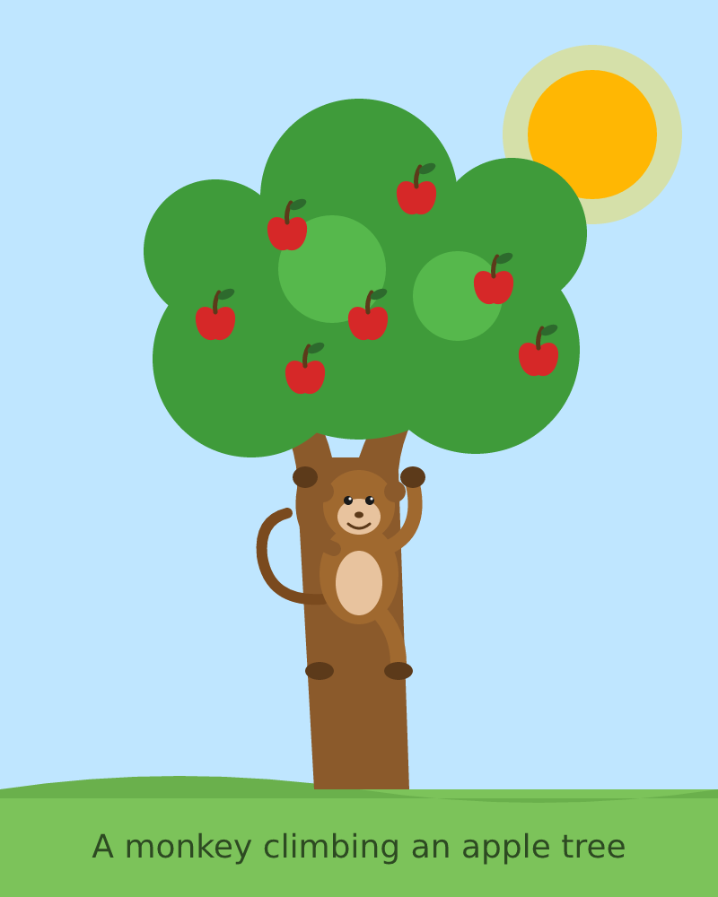 |

Feedback the refiner received for this round (from round 02): 5 defect(s) passed, 0 dropped

- **major** (contact): The two dark brown hand blobs float above the monkey at the base of the leaves and connect to no arm. _Where:_ just under the canopy, above the monkey. _Expected:_ Each hand sits at the end of an arm and grips the trunk or a branch.
- **major** (count): There is only one clear arm, and one leg is missing. The feet are loose dark ovals that are detached from the body. _Where:_ the monkey's arms and legs. _Expected:_ The monkey has two arms and two legs, each attached to the body and ending in a hand or foot on the trunk.
- **major** (shape): The left limb is a thin curving line that looks more like a tail than an arm, so the pose is hard to read as climbing. _Where:_ left side of the monkey. _Expected:_ A clear climbing pose, with limbs wrapped around the trunk and a separate tail.
- **minor** (clean): Small dark arcs sit on top of the floating hand blobs like stray marks. _Where:_ the two dark blobs under the canopy. _Expected:_ No stray marks around the hands.
- **minor** (shape): The apples are small round dots with thin hooked stems, so they look like cherries. _Where:_ the fruit in the canopy. _Expected:_ The fruit is clearly apple-shaped.

| | main | background | count | shape | contact | clean | color | total |
|---|---|---|---|---|---|---|---|---|
| reference, judgment | 4 | 5 | 4 | 4 | 4 | 4 | 4 | **29** |
| attempt, judgment | 3 | 4 | 3 | 3 | 2 | 3 | 3 | **21** |

Judge: parity **no**. _Contact differs by 2 (4 vs 2) and the totals differ by 8 (29 vs 21), so rules 1 and 2 both fail, although neither image has a critical defect._

**Attempt defects (judge):**

- **major** (contact): The hands and feet are dark ovals floating on the trunk, not attached to any arm or leg _Where:_ the monkey's left hand and both feet. _Expected:_ Each hand and foot is clearly joined to its limb and grips the trunk
- **major** (count): Only one leg is drawn; the other foot sits alone with no leg leading to it _Where:_ the monkey's lower body. _Expected:_ The monkey has two visible legs, each ending in a foot on the trunk
- **major** (color): The monkey's brown fur is almost the same shade as the trunk, so its outline disappears into the tree _Where:_ the monkey against the trunk. _Expected:_ The monkey stands out clearly from the trunk it is climbing
- **minor** (shape): The monkey is small next to the tree, and its head and body merge into one shapeless blob _Where:_ the monkey's head and torso. _Expected:_ The monkey has a clearly separate head and body and is big enough to be the clear focus
- **minor** (background): A large caption band takes up the bottom of the picture and draws the eye away from the scene _Where:_ bottom strip of grass. _Expected:_ The ground stays a simple setting that does not compete with the monkey and tree

**Reference defects (judge, never shown to the refiner):**

- **minor** (shape): The arms are hard to read: one is a brown blob behind the head with a hand poking out at the top, and the other is only a short stub ending in a round hand _Where:_ the monkey's arms and upper body. _Expected:_ Both arms are clearly visible as limbs reaching up and gripping the trunk
- **minor** (contact): The leg loops and the round feet sit around the trunk without clearly gripping it, so the monkey looks pasted on more than climbing _Where:_ the monkey's legs and feet at the base of the trunk. _Expected:_ The legs visibly wrap around the trunk and the feet press against the bark
- **minor** (clean): A short branch sticks out from behind the foliage on the left and ends abruptly _Where:_ left side of the tree, just below the leaves. _Expected:_ Any visible branch either joins the trunk naturally or is fully hidden by the leaves

**My review:** **Right (no parity).** Better apples, same body: floating hands and feet, one visible leg. The judge gave the same correct defect for the third time; Haiku could not fix it.

---

